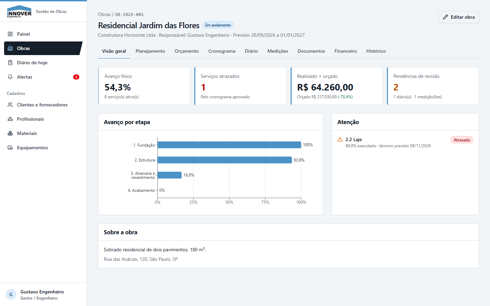
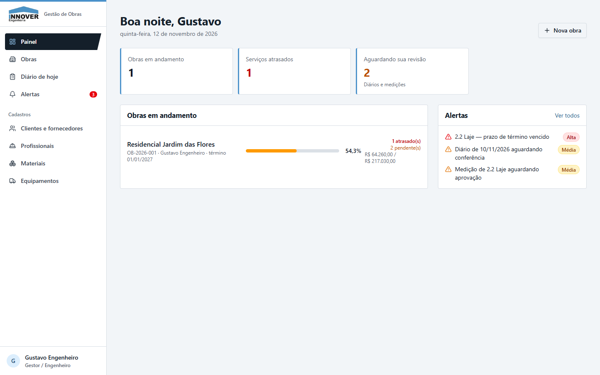
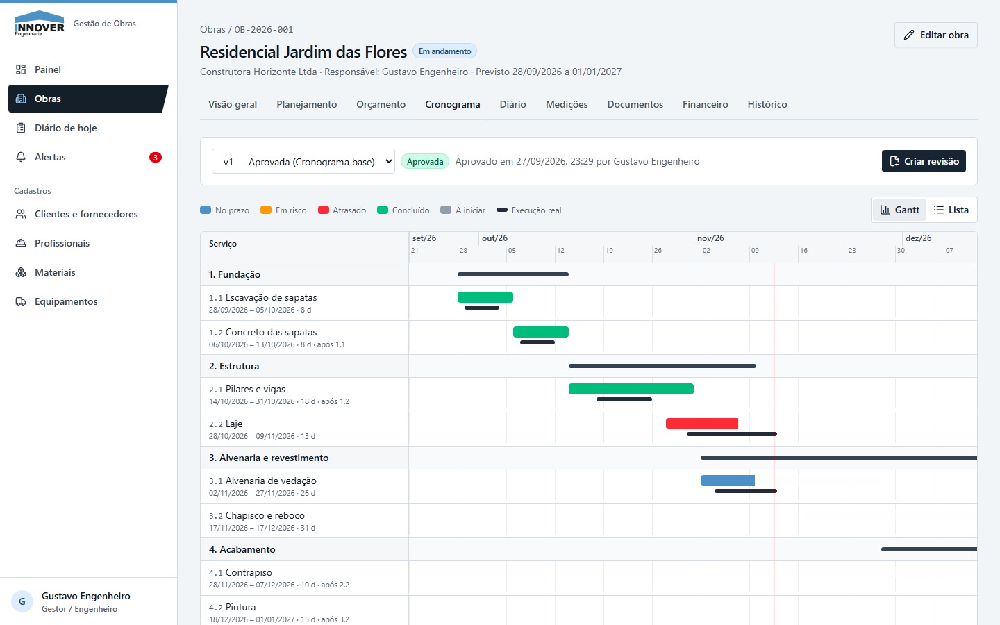
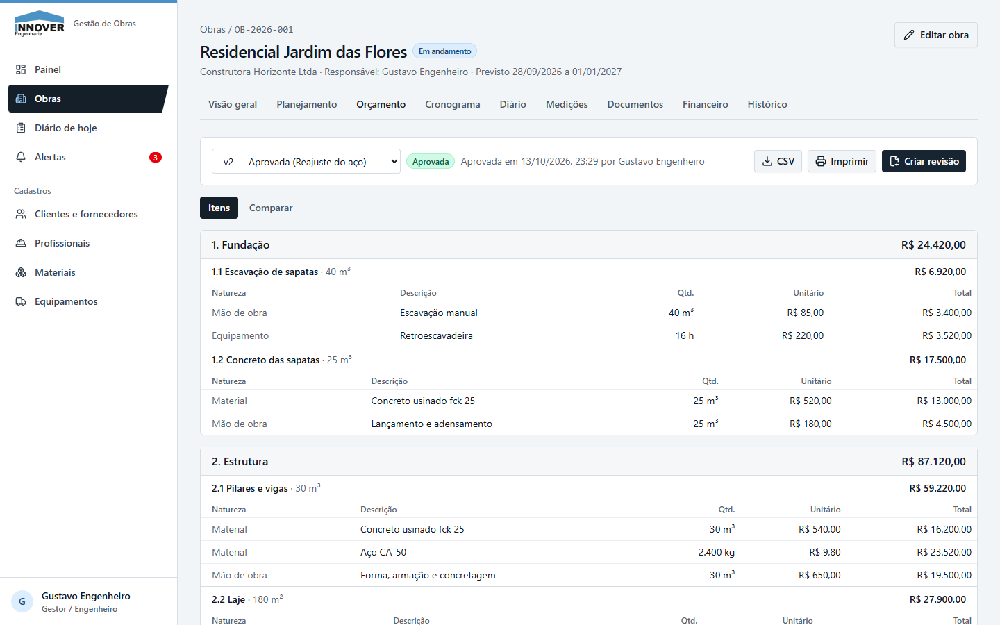
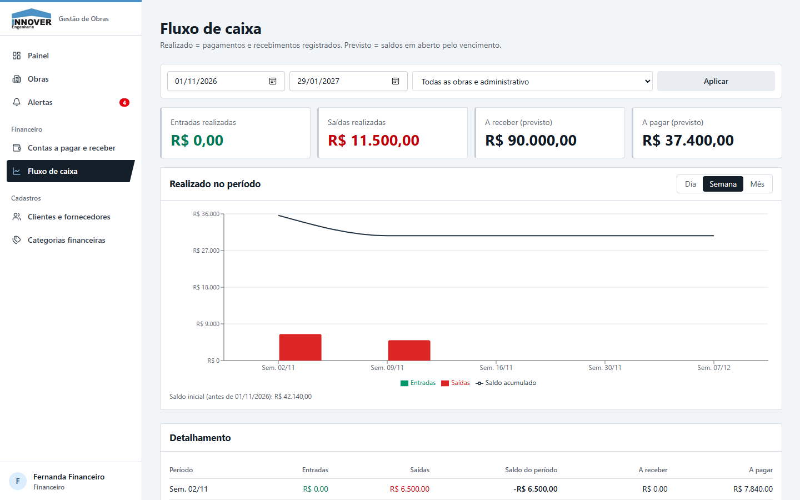
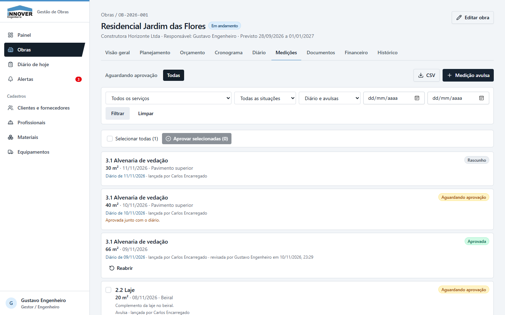
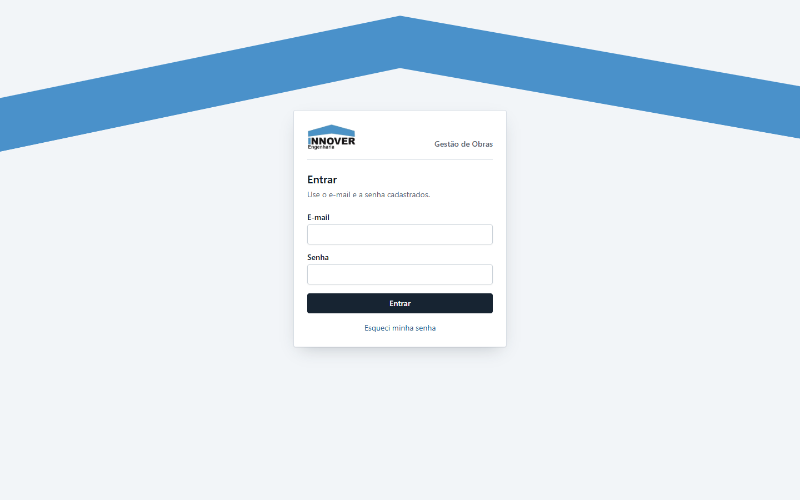
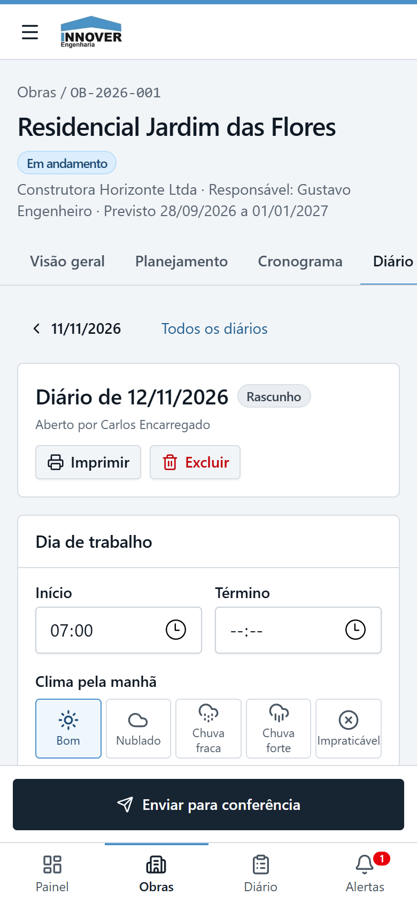

# Gestão de Obras — Innover Engenharia

Sistema web que centraliza o **planejamento, a execução e o financeiro de obras** de uma empresa de engenharia:
orçamento e cronograma com versões, diário de obra feito pelo celular no canteiro, medições com aprovação,
avanço físico calculado automaticamente, contas a pagar e a receber e fluxo de caixa.

**Sistema real, em produção na Innover Engenharia desde novembro de 2026**, feito a partir da
[especificação da empresa](docs/00-especificacao-original.md) para quatro perfis: administrador, engenheiro,
equipe de campo e financeiro.



> As imagens deste README usam apenas os **dados fictícios** de teste (`supabase/seed.sql`).

---

## O problema

Em uma construtora pequena, cada obra vive espalhada: orçamento numa planilha, cronograma em outra, o diário de obra
em caderno ou WhatsApp e as contas no banco. Ninguém sabe ao certo **quanto da obra está pronto**, **se o custo está
dentro do orçado** ou **quem aprovou o quê**. O sistema junta tudo num lugar, com cada pessoa vendo só o que precisa.

## Funcionalidades

| Área | O que faz |
|---|---|
| **Planejamento** | Etapas e serviços com unidade e quantidade prevista; peso de cada serviço no avanço calculado pelo orçamento |
| **Orçamento** | Itens por natureza (material, mão de obra, equipamento); versões com rascunho, aprovação e revisão; comparação entre versões e orçado × realizado; exportação CSV e impressão |
| **Cronograma** | Gantt próprio com dependências, detecção de ciclo e "empurrar sucessores" mantendo a duração; versões aprovadas imutáveis |
| **Diário de obra** | Feito no celular: equipe, clima, serviços executados, materiais, equipamentos e ocorrências; envio, pedido de correção e aprovação; versão para impressão em A4 |
| **Medições** | Lançadas pelo diário ou avulsas; aviso de excesso com justificativa obrigatória; bloqueio de duplicidade; aprovação em lote |
| **Documentos** | Upload de projetos, plantas e contratos com versões e barra de progresso; links de download assinados |
| **Financeiro** | Contas a pagar e a receber parceladas, pagamentos parciais com comprovante, estorno, cancelamento, aviso de duplicidade e fluxo de caixa por dia, semana ou mês |
| **Painel e alertas** | Painel por perfil, serviços atrasados, diários aguardando conferência e contas vencidas |
| **Auditoria** | Histórico de cada alteração: quem fez, quando e o que mudou |

### Perfis de acesso

| Perfil | Pode |
|---|---|
| Administrador | Tudo, em todas as obras, e gerenciar usuários (acesso só por convite) |
| Gestor / engenheiro | Obras de que é membro: planejamento, orçamento, cronograma, aprovar diários e medições |
| Equipe de campo | Diário e medições das suas obras. **Não vê nenhum valor em R$** |
| Financeiro | Contas a pagar e a receber, pagamentos e fluxo de caixa |

## Telas

| | |
|---|---|
|  |  |
| **Painel** do engenheiro: obras, atrasos e pendências | **Cronograma** em Gantt: previsto × execução real |
|  |  |
| **Orçamento** com versões e aprovação | **Fluxo de caixa** realizado e previsto |
|  |  |
| **Medições** com aprovação e justificativa de excesso | **Login** com a identidade da empresa |

<p align="center">
  <br>
  <b>Diário de obra</b> pensado para o celular, no canteiro
</p>

---

## Decisões técnicas

**Segurança e regras de negócio moram no banco, não na tela.**

- **Row Level Security em 26 de 26 tabelas**, com 87 políticas. A chave pública do Supabase vai para o navegador
  de propósito: o que protege os dados é o banco, conferindo perfil e obra de quem consulta.
- **Regras críticas em triggers e funções do Postgres** (76 triggers, 72 funções). Exemplos: versão aprovada de
  orçamento ou cronograma não pode ser alterada; diário enviado só o gestor edita; medição duplicada é recusada;
  status só muda pelas funções de aprovação. A interface valida antes para dar uma mensagem amigável, mas nunca é a
  única barreira.
- **Nada é apagado de verdade**: registros de negócio são desativados, cancelados ou estornados, e uma tabela de
  auditoria guarda o "antes" e o "depois" de cada alteração.
- **Dinheiro em `numeric(14,2)`**, nunca `float`; somas e indicadores calculados em views SQL.
- **Datas com fuso explícito** (`America/Sao_Paulo`): datas de calendário como `date`, eventos como `timestamptz`.
- **Server Components e Server Actions** (Next.js App Router): leitura no servidor, escrita validada com zod,
  e a chave de administração do banco nunca chega ao navegador.
- **Endurecimento extra**: CSP e HSTS, visitante sem login sem acesso a nada do banco, funções internas fora da API,
  proteção contra redirecionamento aberto e contra fórmulas maliciosas em CSV.
- **Celular primeiro**: toda tela funciona a partir de 360 px; tabelas largas viram cartões.

Detalhes em [`docs/02-arquitetura.md`](docs/02-arquitetura.md), [`docs/04-regras-negocio.md`](docs/04-regras-negocio.md)
e [`docs/05-permissoes.md`](docs/05-permissoes.md).

## Qualidade e testes

| Verificação | Resultado |
|---|---|
| Testes de banco com **pgTAP** (regras de negócio e permissões, perfil por perfil) | 137 testes |
| **Ataques diretos à API** com cada perfil, sem passar pelas telas (`scripts/teste-seguranca.ts`) | 113 de 113 barrados |
| Testes unitários com **Vitest** (formatação, parcelas, cronograma, auditoria) | 25 testes |
| Roteiro de **testes manuais** no navegador com os quatro perfis | [`docs/09-roteiro-testes.md`](docs/09-roteiro-testes.md) |
| Revisão de segurança antes do deploy, com o Security Advisor do Supabase | [`docs/10-seguranca.md`](docs/10-seguranca.md) |
| No GitHub | CodeQL, Dependabot, Secret scanning com Push protection |

## Stack

- **Next.js 15** (App Router, Server Components, Server Actions), **React 19**, **TypeScript** em modo `strict`
- **Tailwind CSS 4**, shadcn/ui, lucide-react e recharts
- **Supabase**: Postgres 15, Auth, Storage e RLS
- **zod 4** na validação; **Vitest** e **pgTAP** nos testes
- Hospedagem na **Vercel** e banco no **Supabase Cloud**, ambos na região São Paulo

| Números | |
|---|---|
| Telas | 33 |
| Tabelas / views | 26 / 10 |
| Migrations SQL | 11 (3,2 mil linhas) |
| Código TypeScript | 14 mil linhas |

---

## Rodar no computador

Pré-requisitos: **Node 20+**, **Docker Desktop aberto** e Git.

```bash
npm install
npx supabase start
```

Copie `.env.example` para `.env.local` e preencha com os valores de `npx supabase status`
(`API_URL`, `ANON_KEY` e `SERVICE_ROLE_KEY`). Depois:

```bash
npx supabase db reset --local
```

```bash
npm run dev
```

Abra http://localhost:3000.

### Usuários de teste (só no banco local)

Criados pelo `supabase/seed.sql`, todos com a senha de teste definida no topo desse arquivo.

| E-mail | Perfil |
|---|---|
| admin@teste.local | Administrador |
| gestor@teste.local | Gestor (obras A e B) |
| gestor2@teste.local | Gestor (obra C) |
| campo@teste.local | Campo (obra A) |
| financeiro@teste.local | Financeiro (obras A e B) |
| inativo@teste.local | Desativado (não entra) |

E-mails enviados localmente (convites, recuperação de senha) aparecem em http://localhost:54324.
O painel do banco local fica em http://localhost:54323.

### Verificação completa

```bash
npm run lint && npm run typecheck && npm test && npx supabase test db
```

```bash
NEXT_DIST_DIR=.next-verificacao npm run build
```

Teste de segurança (ataques diretos à API com cada perfil, incluindo arquivos). Rode logo depois de um `db reset`:

```bash
npx tsx scripts/teste-seguranca.ts
```

## Colocar no ar

Passo a passo completo (Supabase, Vercel, e-mails e primeiro administrador): [`docs/11-deploy.md`](docs/11-deploy.md).

Mudanças no banco nunca editam uma migration já aplicada: cada mudança é um arquivo novo em `supabase/migrations/`,
testado no banco local antes do `npx supabase db push --linked`.

## Estrutura

```
docs/                 especificação, escopo, arquitetura, regras, permissões, telas, testes, segurança e deploy
supabase/migrations/  banco: tabelas, regras (triggers), permissões (RLS), views
supabase/tests/       testes pgTAP das regras e permissões
supabase/seed.sql     dados de teste (somente local)
supabase/templates/   e-mails de convite e recuperação de senha
src/app/              telas (Next.js App Router) e ações do servidor
src/components/       componentes de interface
src/lib/              utilitários (formatação, autenticação, upload, auditoria, cálculos)
scripts/              primeiro administrador e teste de segurança
```

---

Desenvolvido por **[Sérgio Frazon](https://github.com/sergio-frazon)**.
